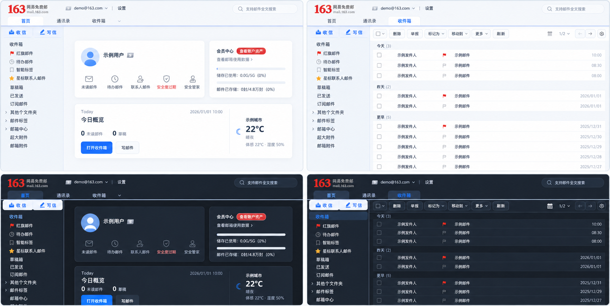

# 163 Mail Minimal

[](https://github.com/zhangchengxuv/163-Mail-Apple-Minimal/actions/workflows/ci.yml)
[](https://github.com/zhangchengxuv/163-Mail-Apple-Minimal/releases/latest)

A Manifest V3 extension for NetEase 163 Mail JS6 with focused cleanup, an Apple Mail-inspired appearance, a minimal home, and optional weather.

## Preview



> Every account, avatar, contact, message subject, timestamp, storage value, and weather value in this preview is anonymized demo content.

## Highlights

- Removes home-page advertising, AI, and nonessential promotional entries.
- Light, dark, and system appearance modes, plus 13–16px mailbox UI sizing.
- A minimal Today card with date, mail summary, shortcuts, and optional weather.
- Leaves message bodies, images, iframes, and rich-text editing content unchanged.

## Install

1. Download and extract the latest ZIP from [Releases](https://github.com/zhangchengxuv/163-Mail-Apple-Minimal/releases/latest), or run `npm run build` locally.
2. Open `edge://extensions` or `chrome://extensions` and enable Developer mode.
3. Choose **Load unpacked** and select the extracted directory or this project's `dist/` directory.

The Release ZIP is an unpacked developer-mode package, not a one-click store installer.

## Privacy

The extension does not upload email content, attachments, cookies, or passwords. When enabled, weather requests use only a user-entered city, or a location explicitly approved by the user; weather data is cached locally for 30 minutes.

## Development

```bash
npm install
npm run typecheck
npm run lint
npm run test
npm run build
```

Pushing a stable `vX.Y.Z` tag runs validation, builds the ZIP and SHA256 file, and creates the matching GitHub Release. Manual CI runs build and tests only.

## License

[MIT](LICENSE)
